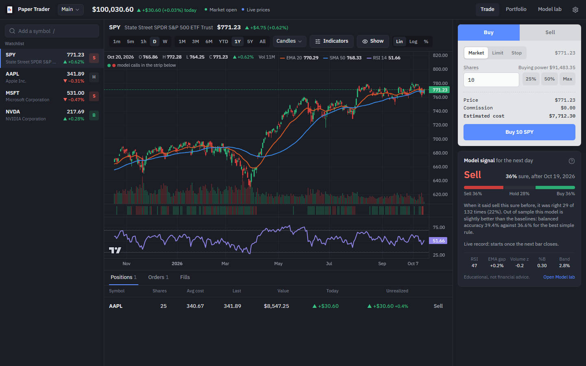

# Paper Trader

[](https://github.com/igoresik/paper-trader/actions/workflows/ci.yml)
[](https://github.com/igoresik/paper-trader/releases/latest)
[](LICENSE)

[](https://www.python.org/)
[](https://fastapi.tiangolo.com/)
[](https://react.dev/)
[](https://scikit-learn.org/)
[](https://sqlite.org/)

A Windows desktop app for practising trades with fake money on real US market prices, with a machine-learning signal that shows its own track record, including when it is no better than guessing.



## Download (Windows)

> [!TIP]
> **On macOS or Linux?** The installer is Windows-only, but the same app runs in your browser with [Docker](#docker): `docker compose up --build`, then open http://localhost:8000. You can also [run it from source](#run-from-source).

1. Get `PaperTrader-Setup-<version>.exe` from the repository's **Releases** page.
2. Run it. It installs for your Windows user only (no admin prompt) and adds Paper Trader to the Start menu. You can tick a desktop shortcut too.
3. Open Paper Trader, name your paper account, pick your starting cash and a few symbols to watch.

Good to know:

- The installer isn't signed, so Windows may say "Windows protected your PC". Choose **More info > Run anyway**.
- The window is drawn by Microsoft Edge WebView2, which comes with Windows 10 and 11.
- The first start after installing takes longer (Windows checks the new files); after that it opens in about two seconds.
- Your data is kept in `%LOCALAPPDATA%\PaperTrader`. Uninstalling (Windows Settings > Apps) leaves it there, so a reinstall keeps your portfolios, and a newer version upgrades the data in place.
- When a new version is out, the top bar links to it. The check is one request to GitHub per start, and it can be switched off in Settings.

## What you can do

- **Trade:** market, limit and stop orders against live prices, by number of shares or by dollar amount. Each fill prints a receipt.
- **Market hours:**
  - Orders placed while the market is closed wait for the next open, as they would at a broker.
  - Practice mode fills them at once at the last price instead.
  - Limit and stop orders fill even if the app was closed when their price came: the app replays the minutes it missed.
- **Short selling:** bet on a price falling. With no shares held, the ticket's Sell becomes **Sell short**, and a short is closed with **Buy back**. As US margin rules ask, the sale's money stays as collateral with half as much again from your cash. If the price rises until that collateral is only 130% of what buying back costs, the app buys the short back for you, at that price or at the open after a jump, even if the app was closed. A jump too big for your cash buys back as many shares as it can pay for. One order never goes from long to short or back.
- **Costs:** a commission per order, a commission as a percentage of the order, and slippage. Every rounding goes against you, so the paper ledger can never create money.
- **Charts:**
  - Six chart types, and linear, log or percent scales.
  - Bar sizes from 1 and 5 minutes to hourly, daily and weekly. Minute candles form live from the price stream; Yahoo keeps a week of 1-minute and two months of 5-minute history.
  - Two moving averages, Bollinger bands, volume, RSI and MACD.
  - Your fills, your average cost and your open orders, drawn on the chart.
  - Every choice is remembered.
- **Portfolios:** several of them. A reset keeps the old one as a read-only record. Positions show live profit and loss, the equity curve is compared with SPY, and the trade ledger can be paged, filtered and exported to CSV.
- **Report card:** the honest test the model gets, applied to you: how many closed trades (sales and buy-backs) made money, average win and loss, your biggest drop, what commission and slippage cost you, how often you were in the market, and how SPY and SPY's model did over the same days.
- **Replay:** trade a symbol's past one day at a time, seeing only the days up to the replay's date. A year takes an afternoon instead of a year, and the report card compares you with buying and holding and with the model's out-of-sample calls for the same days.
- **Model lab:** change how the model works and test it the honest way, then pick which test drives the live signal.
- **Stock splits:** held shares, open orders and the model's record move to the new share count. A reverse split that leaves part of a share pays that part out in cash.
- **Look:** dark or light, or follow Windows. Up and down colours can be green/red, red/green, or blue/orange for colour-blind eyes. Direction always comes with an arrow and a sign as well.

## How the model is tested, and what it shows

There are two models, both random forests by default (gradient boosting is the other choice), trained on all of a symbol's daily history (SPY: from 1993):

- **The signal** guesses whether the next bar closes more than 0.5% up (BUY), more than 0.5% down (SELL), or in between (HOLD).
- **The move reading** guesses whether the next bar moves more than usual, either way. Usual is the median size of the last 60 moves, so about half of all days are bigger.

Their inputs, all known by the bar's close:

- the 14-bar RSI
- the gap between the 12- and 26-bar EMAs, as a share of the price
- volume against its own last 20 bars
- the Bollinger %B and band width
- the 5- and 20-bar moves
- market context: the VIX, its 5-day change and the 10-year Treasury yield's 5-day change (a daily bar sees that day's close; an hourly bar only the day before's)
- the volatility regime: the last 5 bars' volatility against the last 60's, and the latest 1- and 5-bar moves measured in volatility

It is never tested on a random split, because that would let the future leak into the past.

**Walk-forward validation.** It trains on the past, tests on the next block of bars, and rolls forward, five times. On the same bars it is compared with three simple rules: always the most common outcome, always BUY, and "same as yesterday".

**Backtest.** Buying on its BUY calls is compared with buying and holding over the same days, after a cost on every trade. A second strategy holds between half and all of the money, more when the model leans up harder than usual, and is compared with holding its average amount all the time: holding 75% of a rising market beats sitting in cash whatever the model says, so only the gap between those two is the model's doing. A third holds less, down to half, when the move reading expects a bigger move than usual, and is compared with holding its average amount the same way. On SPY, QQQ, IWM and DIA (runs on 22 October 2026, default settings) it trailed that steady amount on all four, in return and in Sharpe: big moves go both ways, and on SPY the days rated likeliest to move big rose the most on average.

**Live record.** The signal you see for each day is stored before the outcome is known, so the live record can't be rewritten by retraining.

**Could it be luck?** The edge over the best simple rule gets a likely range, from resampling the tested days in blocks of 20 (neighbouring days move together, so single days would overstate the evidence). Every Model lab run on the same data is another chance to look good by luck, so the range widens with each one. The verdict follows the range: better only when the whole range is above zero.

**Is this call worth anything?** A Buy or Sell only shows when calls like it, at that confidence and out of sample, got the direction right on the days that moved clearly more than half the time, and clearly more often than that direction came anyway. SPY went up on about 54% of the days that moved, so a Buy that is right 55% of the time only follows the drift. Otherwise the card says **No clear edge** and shows which way the model leans. Hold never shows as a call on its own: how big the move will be is the move reading's question, and it gets the same test (right clearly more often than that happens anyway).

On SPY's whole history (a run on 21 October 2026, tested on 7,050 days from October 1998 on), the honest answer was:

| | Model | Best simple rule | Likely edge |
|---|---|---|---|
| Up, flat or down (balanced accuracy) | 44.8% | 35.4% | +7.7 to +11.0 points |
| Up or down alone, on days that moved | 52.0% | 54.5% (always up) | likely 50.1% to 54.0% |
| Bigger move than usual (balanced accuracy) | 59.5% | 50.6% | +7.1 to +10.1 points |

So the model can't tell which way SPY goes next: 52% is barely better than tossing a coin, and worse than always guessing up, because SPY rose on 54.5% of the days that moved. Following its buy calls returned +166% against +696% for buy and hold. What it can tell is whether a bigger move than usual is coming, mostly from the VIX, in every block of years tested, including 2021 to 2026. The app shows exactly that: most days the signal says **No clear edge**, and the move reading carries the part that works. Trained on five years instead of all of SPY's history, the same test swung between "not clearly better" and "better" from one day to the next. It is for learning, not for trading real money.

**Model lab options.** Two more things can be tried, both off by default:

- **First barrier:** instead of the next bar, the call is which the close reaches first within 2 to 20 bars: up by a barrier (BUY), down by it (SELL), or neither (HOLD). The barrier is the last 20 bars' volatility stretched to that many bars. The last training bars before each test block are left out, because their labels look into the block, and since calls a day apart share most of their path, each stretch of that many bars counts once when judging whether a call is worth anything. On SPY, over 5 days, up or down alone was right 55.7% of the time (likely 50.8% to 60.4%), and the up barrier came first 52.0% of the time anyway. That beats the next-day call (52% against 54.5% for always up), but the likely range still reaches below always guessing up. On AAPL and MSFT it stayed near a coin toss.
- **Drop inputs that don't help:** each training window fits on its first 80%, keeps the inputs whose shuffling hurts its last 20%, and refits with those, so the bars it is tested on never pick them. On SPY, AAPL and MSFT it helped one, hurt one and changed nothing on the third.

## Run from source

Needs **Python 3.12 or newer** (CI runs 3.14) and **Node.js 22.22+ or 24.15+** (what the UI's build and test tools ask for).

First make a virtual environment and switch it on.

Windows (PowerShell):

```powershell
py -m venv .venv
.venv\Scripts\Activate.ps1
```

macOS / Linux:

```sh
python3 -m venv .venv
source .venv/bin/activate
```

Then, the same everywhere:

```sh
python -m pip install -r requirements-dev.txt
cd ui
npm ci
npm run build
cd ..
python -m papertrader serve
```

Then open http://127.0.0.1:8000. On Windows, `python launcher.py` opens the desktop window instead. For UI work with instant reload, keep `serve` running and start `npm run dev` in `ui/`.

If PowerShell won't run `Activate.ps1`, use `.venv\Scripts\activate.bat` from Command Prompt instead. Data from a source run is kept in `data/` in the repository folder, which git ignores.

Command line:

- `python -m papertrader ingest SPY` downloads all of SPY's daily bars (back to 1993) and stores their indicators (`--interval 1h` for the last two years of hourly bars).
- `python -m papertrader train SPY` runs the walk-forward test and prints each fold, the baselines and the backtest against buy-and-hold (`--activate` makes it the live model).

The API is documented at http://127.0.0.1:8000/docs.

## Build the installer

`pwsh -File build.ps1` builds the UI, bundles the app with PyInstaller and wraps it with Inno Setup 6 (`winget install JRSoftware.InnoSetup`). The result is `dist\PaperTrader-Setup-<version>.exe`. Pushing a `v*` tag makes GitHub Actions build it and attach it to a release.

## Docker

`docker compose up --build` runs the same app without the desktop window at http://localhost:8000. It only listens on this computer, because the app has no login. Data lives in the `paper-data` volume.

## Layout

| Path | What it does |
|---|---|
| `papertrader/ledger.py` | Portfolios, orders, fills and positions; every change is one all-or-nothing transaction |
| `papertrader/market.py` | Yahoo Finance history in SQLite, symbol checks, New York trading hours |
| `papertrader/features.py` | RSI, EMA spread, volume z-score, Bollinger, MACD, the volatility regime; next-bar, move and first-barrier labels; the feature store |
| `papertrader/model.py` | Walk-forward validation, baselines, backtest, live signals |
| `papertrader/worker.py` | Live price stream, order matching on its own thread, catch-up after gaps, split checks |
| `papertrader/replay.py` | Replays: a portfolio with its own clock, stepped through history a day at a time |
| `papertrader/updates.py` | The optional check for a newer release |
| `papertrader/api.py` | FastAPI routes and the WebSocket for live updates |
| `papertrader/desktop.py` | The desktop window around the API |
| `papertrader/schema.sql`, `papertrader/db.py` | The database, and the numbered upgrade steps that keep installed copies' data |
| `ui/` | The React app (Vite, TypeScript, Tailwind, Lightweight Charts) |
| `tests/` | pytest suite (ledger, market data, features, model, replay, API) |
| `PaperTrader.spec`, `installer.iss`, `build.ps1` | The Windows build |
| `scripts/make_icon.py` | Draws `assets/icon.ico` |

## Data

- Money is stored in whole cents and shares as whole numbers, so no amount goes through floating point.
- Every write runs in a `BEGIN IMMEDIATE` transaction. Two orders can't both spend the same cash, and a `CHECK` constraint makes negative cash impossible even if the code had a bug. Shares only go below zero as a short.
- The `trades` table is the audit log. Database triggers refuse any change or deletion.
- A position keeps its total cost, not a rounded average, so selling part of it never leaves a few cents behind.
- Bars are split-adjusted, as brokers chart them, and are downloaded again when stale, because Yahoo re-adjusts old bars after a split. Only complete bars are stored.
- Splits are kept with the day they took effect, so old fills and old signals can be put on today's share count.
- A newer version upgrades the database one numbered step at a time, so an installed copy keeps its data. Before the first step it saves a copy of the old database next to it (`papertrader-v<old version>-backup.db`).
- When Yahoo Finance stops answering, a banner says so. Waiting orders stay in place and fill once prices come back.

## Safety

- **Only this computer can reach the app.** Its server answers on 127.0.0.1 only, on a new port each start.
- **Websites can't get in through a trick domain.** A website you visit can't reach it by pointing its own domain at your computer: requests addressed to any other host are refused.
- **Websites can't place orders or change anything.** Orders are only accepted as JSON, which browsers don't send across sites without permission, and the app gives none. Any request that changes something is also refused when it comes from another site's page.
- **Websites can't listen to the live updates.** The live-update connection checks which page opened it.
- **Nothing to steal.** There are no passwords, keys or real money in the app, and trained models are never saved as files that could run code when loaded.
- **What leaves your computer:** requests to Yahoo Finance for prices, and, unless you switch it off, one request to GitHub per start to look for a new version. Neither carries anything about you or your trades.

## Tests

With the virtual environment switched on:

```sh
python -m pytest
cd ui
npm test
```

## Credits

- Prices come from Yahoo Finance through [yfinance](https://github.com/ranaroussi/yfinance). Yahoo allows this for personal use, and quotes can be late or missing. The data is never stored in this repository.
- Charts are drawn with [TradingView Lightweight Charts](https://www.tradingview.com/lightweight-charts/)&trade;, &copy; TradingView, Inc., under the Apache License 2.0.

## License

MIT, see [LICENSE](LICENSE). What changed in each version is in [CHANGELOG.md](CHANGELOG.md).

Educational software. Not financial advice.
